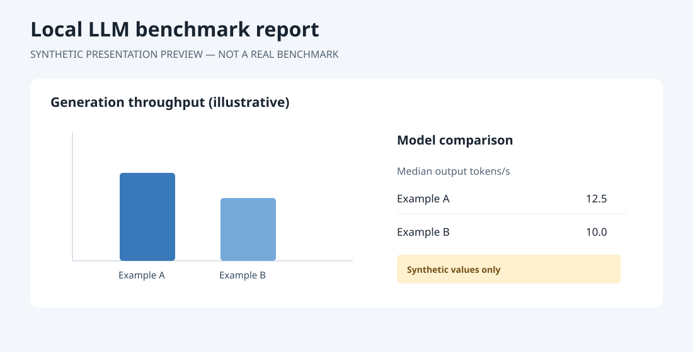
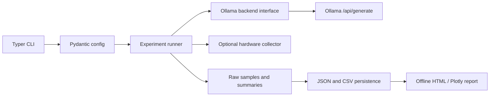

# Local LLM Benchmarks

[](https://github.com/OscarJHernandez/gmktec-evo-x2-local-llm-benchmarks/actions/workflows/ci.yml)
[](LICENSE)

Reproducible, local-first measurements of LLM inference using Ollama. Preserve raw
samples and compare generation throughput, prompt processing, client-observed
latency, model loading and host memory without uploading prompts or results.

## Status and scope

Milestone 1 supports the Ollama `/api/generate` endpoint. Three deterministic
workloads cover short input, long input and longer generation. The framework
records Ollama server timings separately from Python-client measurements and
persists every sample. No model is downloaded by the base CLI benchmarks; the opt-in Makefile catalog workflow explicitly downloads eligible Ollama models.

## Quick start

Install Python 3.10+ and [uv](https://docs.astral.sh/uv/), then:

```console
git clone https://github.com/OscarJHernandez/gmktec-evo-x2-local-llm-benchmarks.git
cd gmktec-evo-x2-local-llm-benchmarks
uv sync
uv run llm-bench doctor
uv run llm-bench models
uv run llm-bench run --model qwen3.5:9b --repeat 5
uv run llm-bench compare --models qwen3.5:9b,qwen3.5:27b
uv run llm-bench report --output report.html
```

Start Ollama separately and explicitly pull any models you choose before running
benchmarks. The default endpoint is `http://localhost:11434`; set `OLLAMA_HOST`
or pass `--api-url`. Use `LLM_BENCH_RESULTS_DIR` or `--output-dir` to change the
ignored-by-default `results/` directory.

```console
$ uv run llm-bench run --model qwen3.5:9b --repeat 5
             ┏━━━━━━━━━━━━━━━━━┳━━━━━━━━━━━━━━━━━━━━━━┳━━━━━━━━━━━━━━━━━━━━━┳━━━━━━┓
             ┃ Workload        ┃ Median output tok/s  ┃ Median client TTFT ┃ Runs ┃
             ┡━━━━━━━━━━━━━━━━━╇━━━━━━━━━━━━━━━━━━━━━━╇━━━━━━━━━━━━━━━━━━━━━╇━━━━━━┩
             │ short-input     │ ...                  │ ...                 │ 5    │
             │ long-input      │ ...                  │ ...                 │ 5    │
             │ long-generation │ ...                  │ ...                 │ 5    │
             └─────────────────┴──────────────────────┴─────────────────────┴──────┘
Saved raw measurements: results/qwen3.5_9b-<UTC timestamp>.json
```

Dots above are format examples, not measured values. The sample report and
`examples/synthetic-example.json` contain synthetic illustration values only.
Open [`examples/sample-report.html`](examples/sample-report.html) locally; it
is self-contained and explicitly marked synthetic.

## Automated EVO-X2 model catalog

The default Makefile workflow evaluates a broad catalog of 44 explicit local
Ollama tags, **plus any additional installed generative models**. It evaluates
memory and disk headroom before downloading, pulls missing candidates through
Ollama's local `/api/pull` endpoint, then runs repeated measurements for each.
Pull failures and runtime failures are recorded and do not abort subsequent models.
**No model is downloaded by the ordinary `llm-bench run` or `compare` commands.**

```console
make setup
make models
make benchmark-start                  # auto-pull eligible catalog models; 50 repetitions
make benchmark-status                 # tmux session active or stopped
make benchmark-logs                   # latest benchmark messages
make benchmark-stop                   # stops bench process, not Ollama itself
make benchmark-export                 # tidy CSV/JSONL for pandas/PyMC
```

To benchmark everything **already installed**, without downloading:

```console
make benchmark-start MODELS=installed REPEAT=50
```

To benchmark only selected installed tags:

```console
make benchmark-start MODELS=qwen3.5:9b,qwen3.5:35b REPEAT=50
```

Override `NUM_CTX=16384`, `NUM_PREDICT=512`, or `THINK=on` if needed.
Use `CATALOG_FILE=/path/to/extra-models.json` to add local Ollama tags
(`[{"name":"custom:8b","size_gb":5.5}]`), with an estimated artifact size.
The default store path is `OLLAMA_MODELS` or `~/.ollama/models`; if Ollama
runs as a system service with a different storage location, set
`MODEL_DIR=/path/to/actual/ollama/models` for accurate disk checks.

**Capacity caveats:** 128 GB unified RAM does not imply every 70B/120B model
will run efficiently or load at every context size. The fit preflight conservatively
reserves 24 GiB of RAM plus 30% above estimated weight sizes, and reserves
20 GiB of disk plus 15% above advertised model artifacts. Published sizes can
change; neither heuristic certifies a successful load or full GPU residency.
The catalog deliberately excludes cloud-only and obviously oversized variants.
The public Ollama library contains many thousands of tags: this is an expandable
curated set, **not an exhaustive remote registry crawler**. Automatically
downloading the entire eligible set may consume hundreds of GB of storage
and considerable time. The system never deletes installed Ollama models.

Each completed model writes a uniquely identified experiment JSON into ignored
`results/`. Per-candidate status and skip/failure reasons are flushed immediately
to `results/catalog-progress-*.jsonl`; an interruption retains the completed
model experiments, but the current unfinished model may need rerunning.
`benchmark-export` creates snapshot CSV/JSONL rows with model digest,
experiment ID, metric, workload, repetition, timing, context, and cache status.
Raw JSON remains the source of truth. See [model catalog notes](docs/model-catalog.md).

## Measurements and methodology

- Generation throughput uses Ollama `eval_count / eval_duration`.
- Prompt throughput uses `prompt_eval_count / prompt_eval_duration`. Each sample
  carries cache status; only explicitly uncached samples enter the uncached
  aggregate. Cached and unavailable cache states have separate summaries.
- Client time to first output is the elapsed time until the first non-empty
  streamed response chunk. This is not token-level timing: `/api/generate`
  streams text chunks, not individual token IDs.
- Client end-to-end duration comes from a monotonic clock. Server-reported
  `total_duration`, `load_duration`, and evaluation durations are kept separately
  in nanoseconds converted to seconds.
- An initial candidate is labeled cold-start only if Ollama reports a positive
  model load duration. If the model was already resident, the sample is labeled
  warm-start and the report warns that cold loading was not observed. Configured
  warm-ups are then run before measured samples labeled `warm_start`.
- Output token limits are passed to Ollama. A zero-token response or API
  `done_reason` of `length` / `max_tokens` is flagged; every raw measurement,
  including flagged data, remains available for audit.
- Fixed prompts, seed, context length, temperature, thinking mode, requested
  limits, actual token counts, model digest/quantization, UTC timestamp,
  environment, repetitions and framework version are recorded.

Ollama does not consistently expose prompt-cache telemetry. An unknown cache
state is never silently described as uncached. A cache state explicitly marked
cached remains separate from unknown and uncached samples. Prompt cache details
and server field availability can vary by Ollama version.

## Example report

The following preview is a designed example, not a screenshot of a real GPU run.
The full interactive charts and raw sample table are in the offline HTML report.



## Hardware support and privacy

Host OS, Python, CPU model, core count and system RAM statistics are collected
when available. GPU information is optional. A Python GPU collector can be
injected through `run_benchmark(..., gpu_collector=...)`; collector errors are
ignored and missing values remain empty. No collector is enabled by default.
The project does not treat AMD VRAM/GTT address-space limits as physical GPU
memory consumption.

The initial development target is a GMKtec EVO-X2 with Ryzen AI Max+ 395 and
Radeon 8060S (`gfx1151`), 128 GB unified RAM, Ubuntu and ROCm. This is a target
configuration, not a claim that this code or benchmark has been run on that
hardware. Reports omit API URLs, hostnames, usernames, IP addresses and paths.
Local output under `results/` is git-ignored; synthetic examples are separate.

## Architecture



`src/llm_bench` separates backend I/O, workload definitions, orchestration,
hardware collection, schemas, persistence, report rendering and CLI commands.
Only Ollama is implemented; the backend boundary supports future engines without
pretending those engines are currently supported.

## Commands

```console
llm-bench doctor [--api-url URL]
llm-bench models [--api-url URL]
llm-bench run --model MODEL [--repeat N] [--warmup N] [--api-url URL] [--csv]
llm-bench compare --models MODEL_A,MODEL_B [--repeat N] [--warmup N]
llm-bench report [--input results] [--output report.html] [--csv output.csv]
```

`report` reads experiment JSON files from a path or directory. Reports contain
configuration, host memory, model comparisons, generation and latency charts,
variability, individual benchmark rows, warnings, and cache/load limitations.
HTML embeds Plotly JavaScript for offline viewing. CSV is an optional flat export
of per-run metrics.

## Development

```console
uv sync --extra dev
uv run ruff format --check .
uv run ruff check .
uv run mypy
uv run pytest
uv build
```

Tests use mocked Ollama responses and require neither Ollama nor a GPU. See
[CONTRIBUTING.md](CONTRIBUTING.md) and
[docs/adding-a-backend.md](docs/adding-a-backend.md) before submitting changes.

## Limitations and roadmap

Cold start is observed only when Ollama reports a positive `load_duration`;
there is no portable API to force a server-wide unload. Time-to-first-output is
chunk-granular. GPU telemetry is not bundled. Prompt cache information may be
unavailable, in which case it is reported as unknown and excluded from the
uncached summary. Results describe only the recorded environment and settings.

Future work (not implemented): context-length scaling, concurrent load, richer
AMD/NVIDIA/Apple telemetry, llama.cpp, cross-machine historical tracking and
regression detection, and an optional interactive dashboard.
